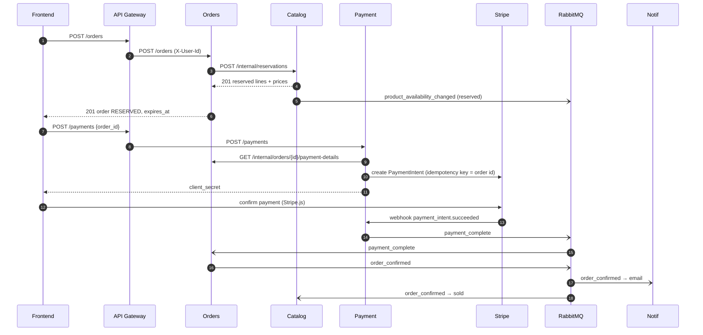

# Service contracts

The exact contracts between the Limited Watches microservices.

| File | Standard | Covers |
|---|---|---|
| [`asyncapi.yaml`](asyncapi.yaml) | AsyncAPI 3.0 | Every RabbitMQ message: exchange, routing key, envelope, payload schema, example, producer and consumer queues |
| [`openapi.yaml`](openapi.yaml) | OpenAPI 3.1 | Every synchronous HTTP call that crosses a service boundary: checkout endpoints, internal service-to-service calls, inbound webhooks |

Both files validate against the official AsyncAPI 3.0 / OpenAPI 3.1 JSON Schemas, and every example in them validates against its own schema.
To browse them: paste `asyncapi.yaml` into [AsyncAPI Studio](https://studio.asyncapi.com) and `openapi.yaml` into [Swagger Editor](https://editor.swagger.io), or use the AsyncAPI / OpenAPI extensions for VS Code.

---

## 1. Conventions (apply to every contract)

| Topic | Rule |
|---|---|
| Ids | UUID v4 strings. A service only creates ids for its own aggregates. |
| Time | ISO 8601 in UTC, e.g. `2026-10-14T10:00:00Z`. |
| VAT | Not calculated anywhere: every price is final, as listed. |
| Money | `{ "amount_minor": 11500000, "currency": "DKK" }`: an integer in minor units (øre / cents) plus an ISO 4217 code. Never floats. The monolith already stores cents. |
| Countries | ISO 3166-1 alpha-2 (`DK`), stored as a plain code (`users.country_code`); there is no countries table. |
| Field names | `snake_case` in all payloads. |
| Unknown fields | Schemas use `additionalProperties: false` so the contract is exact. Consumers should still **ignore** fields they don't know, so adding a field is a non-breaking change. |
| Versioning | Adding an optional field: same event type, bump the spec `version`. Removing or renaming a field, or changing its meaning: publish a **new event type** (`order_confirmed.v2`) alongside the old one until all consumers have moved. |
| Personal data | Only `order.events` and `auction_complete` carry personal data (email, names, addresses). Watch `serial_number` and `internal_id` are never published. On `user_deleted`, every service anonymises what it holds. |
| Errors (HTTP) | RFC 9457 `application/problem+json`, with `type` = `https://limitedwatches.dk/problems/<code>`. |

### Event envelope (CloudEvents 1.0, structured JSON)

Every message body is a CloudEvent. The AMQP content type is `application/cloudevents+json`, and messages are persistent (`delivery_mode = 2`).

```json
{
  "specversion": "1.0",
  "id": "0b8f6c3e-2d1a-4e5f-9a8b-7c6d5e4f3a2b",
  "source": "/services/orders",
  "type": "order_confirmed",
  "time": "2026-10-14T10:04:10Z",
  "datacontenttype": "application/json",
  "subject": "f47ac10b-58cc-4372-a567-0e02b2c3d479",
  "dataversion": 1,
  "correlationid": "f47ac10b-58cc-4372-a567-0e02b2c3d479",
  "causationid": "9b2e5c4d-1a3f-4e6b-8c7d-0f1e2d3c4b5a",
  "data": { "...": "event specific, see asyncapi.yaml" }
}
```

| Attribute | Meaning |
|---|---|
| `id` | Unique per event. **The idempotency key**: consumers record processed ids and skip duplicates. |
| `type` | Event name, identical to the AMQP routing key. |
| `subject` | Id of the aggregate the event is about (user, product, order, auction). |
| `dataversion` | Schema version of `data`. |
| `correlationid` | Id of the whole flow; for checkout it is the order id, so all saga messages can be traced together. |
| `causationid` | `id` of the event or request that caused this event (`null` if a user action). |

---

## 2. RabbitMQ topology

**Exchanges:** one durable `topic` exchange per publishing service. Only the owner publishes to it.

| Exchange | Publisher |
|---|---|
| `user.events` | Users |
| `catalog.events` | Catalog |
| `auction.events` | Auctions |
| `order.events` | Orders |
| `payment.events` | Payment |

**Queues:** each consumer has one durable **quorum** queue per exchange, named `<consumer>.<exchange>`, bound to exactly the routing keys it handles. That means competing instances of the same service share the work, while different services each get their own copy.

| Queue | Bound routing keys |
|---|---|
| `orders.user.events` | user_deleted |
| `catalog.user.events` | user_deleted |
| `messaging.user.events` | user_deleted |
| `editorial.user.events` | user_deleted |
| `auctions.user.events` | user_deleted |
| `search.catalog.events` | product_created, product_updated, product_deleted, product_availability_changed, brand_updated |
| `orders.auction.events` | auction_complete |
| `catalog.order.events` | order_confirmed, order_cancelled, order_expired, order_status_changed |
| `payment.order.events` | order_cancelled, order_expired, refund_requested |
| `notif.order.events` | order_confirmed |
| `orders.payment.events` | payment_complete, payment_failed, payment_refunded |

**Failures:** every queue has `x-dead-letter-exchange = dlx` and a dead-letter queue `<queue>.dlq`. A consumer retries a message 5 times with exponential backoff (1 s → 16 s); after that it is rejected and lands in the DLQ for manual inspection or replay.

## 3. Delivery guarantees

- **At-least-once.** A message can be delivered more than once, but is never lost silently.
- **Producers: transactional outbox.** The state change and the event row are written in the same database transaction (e.g. `orders.status = PENDING` and the `order_confirmed` outbox row). A relay publishes outbox rows with **publisher confirms** and marks them sent. This prevents "saved but never published" and "published but rolled back".
- **Consumers: idempotent inbox.** Ack manually after the handler commits. Store the CloudEvent `id` in a `processed_events` table in the same transaction as the handler's changes, and skip ids already seen.
- **Stateless services: Payment and Notif.** The monolith stores nothing for them (Stripe is the payment record, and emails are sent and forgotten), so they get no database and no outbox or inbox table. They meet the same guarantees like this:
  - Payment publishes from the Stripe webhook handler and answers Stripe `200` only after RabbitMQ confirms the publish; otherwise it answers `500` and Stripe retries the webhook. Stripe's retries do the outbox's job.
  - The CloudEvent `id` of a Payment event is a UUIDv5 of the Stripe event id. A retried webhook therefore produces the same `id`, and Orders' inbox skips it.
  - Payment's own handlers are idempotent through Stripe: cancelling a PaymentIntent that is already cancelled changes nothing, and a refund uses `refund_request_id` as the Stripe idempotency key. Payment finds an order's PaymentIntent with Stripe's search on `metadata.order_id`, both to cancel it and to refund it, so Orders never stores Stripe ids.
  - Notif sends through Resend with the CloudEvent `id` as Resend's idempotency key, so a redelivered `order_confirmed` doesn't send a second email.
- **Ordering.** RabbitMQ keeps order per queue, but retries and multiple consumer instances can reorder messages. User, product and brand events therefore carry an aggregate `version`. A consumer only applies an update whose version is newer than the one it stored, e.g. Search ignores `product_updated` v5 if it already has v6.
- **Consistency.** The Search read model is eventually consistent, typically within seconds. An admin editing a product reads from Catalog, not from Search, so they always see their own change.

---

## 4. Event catalogue

| Event | Exchange | Producer | Consumers: what they do |
|---|---|---|---|
| `user_deleted` | user.events | Users | **Orders, Messaging, Editorial, Auctions** anonymise personal data and keep the id. **Catalog** deletes the user's favorites |
| `product_created` | catalog.events | Catalog | **Search** inserts into the read model |
| `product_updated` | catalog.events | Catalog | **Search** replaces the document |
| `product_deleted` | catalog.events | Catalog | **Search** removes it. Favorites are deleted with the product inside Catalog |
| `product_availability_changed` | catalog.events | Catalog | **Search** shows it as available, reserved or sold |
| `brand_updated` | catalog.events | Catalog | **Search** updates the brand name and slug on every listing with that `brand_id` |
| `auction_complete` | auction.events | Auctions | **Orders** creates a RESERVED order for the winner |
| `order_confirmed` | order.events | Orders | **Notif** sends the confirmation email (all data, including the recipient, is in the event). **Catalog** marks the products sold |
| `order_cancelled` | order.events | Orders | **Catalog** releases stock. **Payment** cancels an open PaymentIntent |
| `order_expired` | order.events | Orders | **Catalog** releases stock. **Payment** cancels the PaymentIntent |
| `order_status_changed` | order.events | Orders | **Catalog** puts the stock back when an admin moves an order from an active status (PENDING, PROCESSING, SHIPPED, DELIVERED) to RETURNED or REFUNDED. Changes only go forward, so an order never becomes active again |
| `refund_requested` | order.events | Orders | **Payment** refunds through Stripe |
| `payment_complete` | payment.events | Payment | **Orders** RESERVED → PENDING plus `order_confirmed`, or `refund_requested` if the order already expired |
| `payment_failed` | payment.events | Payment | **Orders** records the attempt (order stays RESERVED, so the customer can retry) |
| `payment_refunded` | payment.events | Payment | **Orders** sets the order to REFUNDED (a no-op if an admin already set it) |

The full payload schema and an example of each event are in `asyncapi.yaml` under `components/schemas/<Event>Data` and `components/messages`.

Notif only sends the emails the monolith sends today: the order confirmation (from `order_confirmed`) and the contact form (`POST /contact`). More customer emails, e.g. on `payment_failed` or `order_expired`, can be added later by binding more routing keys to `notif.order.events` / `notif.payment.events`; the producers don't change.

---

## 5. Synchronous contracts

| Call | Endpoint | Served by | Exposure |
|---|---|---|---|
| Create order | `POST /orders` (`Idempotency-Key`) | Orders | Public, via gateway, user JWT |
| Get order | `GET /orders/{order_id}` | Orders | Public, via gateway, user JWT |
| List orders | `GET /orders` | Orders | Public, via gateway, user JWT (own orders; admin: all) |
| Cancel order | `POST /orders/{order_id}/cancel` | Orders | Public, via gateway, user JWT (owner, only while RESERVED) |
| Change order status | `PATCH /orders/{order_id}/status` | Orders | Public, via gateway, user JWT (admin) |
| Reserve stock | `POST /internal/reservations` (`Idempotency-Key` = order id) | Catalog | Internal, service JWT |
| Roll back a reservation | `DELETE /internal/reservations/{order_id}` | Catalog | Internal, service JWT |
| Start payment | `POST /payments` | Payment | Public, via gateway, user JWT |
| Amount due | `GET /internal/orders/{order_id}/payment-details` | Orders | Internal, service JWT |
| Stripe webhook | `POST /webhooks/stripe` (`Stripe-Signature`) | Payment | Public, signature-verified |
| Email confirmed | `POST /webhooks/supabase/email-confirmed` (`x-supabasewebhook-secret`) | Users | Public, shared secret |
| Product summary | `GET /products/{product_id}` | Catalog | Public, and internal for Messaging, Editorial and Auctions |
| Contact form | `POST /contact` | Notif | Public, via gateway, no login (as in the monolith) |
| Search products | `GET /search` | Search | Public, via gateway, no login |

How identity and auth work across the gateway:

- **Gateway → services:** the gateway verifies the Supabase JWT (cached signing keys) and forwards `X-User-Id`, `X-User-Role` (`admin` or `customer`, the monolith's `users.role`), `X-User-Email` and `traceparent`. Services accept these headers only from the gateway.

- **Service → service:** calls go to `/internal/*` paths with a service JWT. The gateway does not route `/internal/*`.

- **Service JWT:** there is no token issuer, so the caller signs its own token and sends it as `Authorization: Bearer <jwt>`. HS256 with a secret shared by the two services (env var `INTERNAL_JWT_SECRET`), claims `iss` = calling service (`payment`), `aud` = called service (`orders`), `iat`, and `exp` at most 60 s later. The called service checks the signature, `aud`, `exp`, and that `iss` is a caller it expects, and answers `401` problem+json otherwise. First use: Payment → Orders `GET /internal/orders/{order_id}/payment-details`.

**Data Orders copies.** In the monolith, the order pages and the confirmation email joined `order_items` to the product, watch, brand and image tables, and `orders` to `users`. After the split those tables are in Catalog and Users. So Orders keeps three copied columns: `orders.customer_email` (from `X-User-Email` when the order is created), plus `order_items.product_name` and `order_items.thumbnail_url` (from Catalog's reservation response). Order pages and `order_confirmed` are then served from Orders' own database, with no calls to other services, and the copy shows the product as it was when it was bought.

**Favorites live in Catalog.** The monolith's watchlist query joins `favorites` to products, watches, brands and images and hides watches that are out of stock. Keeping `favorites` in Catalog leaves that a local query, as the teammates' catalogue contract proposed. Catalog deletes a user's favorites on `user_deleted` (the monolith deletes them when an account is deleted), and a deleted product's favorites go with it.

---

## 6. Checkout saga



**Compensation paths:**
- **No payment within 30 min.** Orders → `order_expired`. Catalog releases the stock (`product_availability_changed` → available) and Payment cancels the PaymentIntent.
- **Payment arrives after expiry.** Orders receives `payment_complete` for an EXPIRED order and publishes `refund_requested`. Payment refunds through Stripe, then publishes `payment_refunded`, and Orders sets the order to REFUNDED.
- **Admin changes an order's status.** Unlike the monolith's `changeOrderStatus`, which allowed any change, statuses only go forward: PENDING → PROCESSING → SHIPPED → DELIVERED → RETURNED, plus CANCELLED from PENDING to DELIVERED and REFUNDED from any paid status (a RETURNED order is refunded, not cancelled, since its stock is already back). CANCELLED publishes `order_cancelled`; any other change publishes `order_status_changed`, and Catalog puts the stock back when the order leaves an active status. Setting REFUNDED also publishes `refund_requested` (reason `admin`), so Payment refunds the money through Stripe; the later `payment_refunded` changes nothing.
- **Orders crashes after reserving.** Orders calls `DELETE /internal/reservations/{order_id}`. As a safety net, Catalog itself releases any reservation still active 5 min after its `expires_at`.

---

## 7. Diagrams

- [`../contracts.drawio`](../contracts.drawio): one card per event with its `data` fields, coloured by producer, with the consumers as coloured chips, plus a publishes/consumes matrix.
- [`../architecturev3.drawio`](../architecturev3.drawio): services, datastores, the gateway and the exchanges, with the same producers and consumers as `asyncapi.yaml`.
- [`../microservice-erd.drawio`](../microservice-erd.drawio) and [`../monolith-erd.drawio`](../monolith-erd.drawio): every table, after and before the split.

When a contract changes, update the YAML here first, then the diagrams.

## 8. Open decisions

Tracked in [`DECISIONS.md`](../../../DECISIONS.md) in the repo root.
